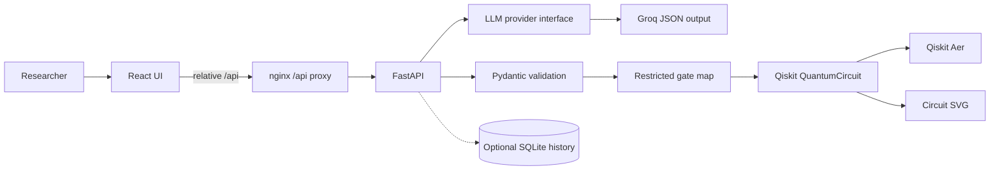

# LLM-Based Quantum Circuit Generation

A research framework that turns a natural-language description of a quantum problem into an executable circuit. A language model returns a structured JSON specification. The backend validates that specification, builds a Qiskit circuit through a fixed gate map, simulates it with Qiskit Aer, and returns the diagram, counts, and probabilities. The React UI shows each of those artifacts.

The framework is meant to be extended. This repository is an MVP of that path. It does not report experimental results, and it does not claim that a model has been evaluated, fine-tuned, or compared against a baseline.

## Research motivation

Natural language is a convenient way to sketch a quantum algorithm, but a generated Python string is a poor interface: it is hard to validate, easy to execute unsafely, and awkward to reuse in later experiments. This project separates three concerns:

1. The model proposes a **circuit specification**, not code.
2. A schema and an allowlist decide whether that specification is executable.
3. A simulator and a diagram are produced from the circuit the backend actually built.

Later work can swap the language-model provider, persist experiment history, or add learning-based circuit optimization. Those pieces have an interface or a noted dependency here. They are not implemented.

## Architecture



The browser talks only to the frontend origin. nginx proxies `/api` to the backend service, so the UI uses relative URLs and does not embed `localhost`. Swagger remains available on the published backend port.

Generation does not wait on the database. If SQLite cannot be opened or a write fails, the request still returns the circuit result.

## Stack

| Layer | Choice |
| --- | --- |
| UI | React, Vite, TypeScript, Tailwind CSS |
| API | Python 3.11, FastAPI, Pydantic v2 |
| Language model | Groq via `GROQ_API_KEY` and `GROQ_MODEL`. Structured JSON when the model supports it. `GROQ_VISION_MODEL` reads images |
| File prompts | `pypdf` for PDF text, `pypdfium2` and Pillow to render scanned pages |
| Quantum | Qiskit and Qiskit Aer. No `eval` or `exec`. No model-authored Python |
| Machine learning | CPU PyTorch in the backend image, imported only for a version check |
| History | Optional SQLite behind a repository interface |
| Runtime | Docker Compose. The host does not need Python or Node |

## Features

- Natural-language generation returns a circuit spec, validation status, and model metadata.
- The prompt box also takes an image or a PDF as the question. See [File prompts](#file-prompts).
- A missing Groq key is a configuration error. The service does not invent a template circuit in its place.
- Validation rejects unsupported gates, bad qubit or clbit indexes, colliding measurement bits, identical control and target, and non-finite rotation angles.
- Supported gates, stored in lowercase: `i`, `x`, `y`, `z`, `h`, `s`, `t`, `rx`, `ry`, `rz`, `cx`, `cz`, `swap`.
- Simulation uses Qiskit Aer with a configurable shot count. Counts and probabilities (`count / shots`) come back with an SVG of the circuit that was built.
- Four predefined reference circuits (Bell, superposition, bit flip, GHZ) can be simulated with no API key. The UI labels them as reference circuits, not model output.
- Request body size, qubit count, shot count, and language-model attempts are bounded by environment variables.
- Malformed JSON, provider errors, and rate limits surface as structured HTTP errors. Attempts back off and stop at `LLM_MAX_RETRIES`.

## Learner and Pro modes

A **Learner / Pro** toggle sits at the top right of the page header. It is a two-option radio group, so arrow keys, Home, and End move the selection. The choice is stored in `localStorage` under `qcg.viewMode`, so a reload keeps it.

- **Pro** is the default. It is the full technical view: stats, gate list, circuit diagram, counts, probabilities, and the raw spec JSON.
- **Learner** explains the same result in plain language for someone new to quantum computing: what the circuit is meant to do (from its name and description), what each gate does in the order applied, what the measurements store and how to read Qiskit bitstrings (the rightmost character is classical bit 0), the outcome percentages for the actual shot count and why small deviations are shot noise, a "Key idea" line for recognisable patterns (superposition, Bell, GHZ, deterministic bit flip), and the validation status. The circuit diagram and histogram stay visible. The stats, gate list, and spec JSON move behind **Show technical details**.

Explanations come from the backend and are built from the validated spec and the simulator counts by fixed rules in `backend/app/services/explanation.py`. No language model is called, so they work without a Groq key and for the reference circuits. They describe this simulation only and do not report experimental results.

- Successful `POST /api/circuits/simulate` and `POST /api/circuits/generate-and-simulate` responses add a `learner_explanation` object with `pattern`, `overview`, `steps`, `measurements`, `bit_order`, `outcome`, `key_idea`, `validation`, and `errors`. Every existing field is unchanged.
- `validation_error` (422) and `measurements_required` (400) error bodies add a top-level `learner_explanation` whose `errors` list explains each validation detail in plain words. The `error` object keeps its shape.

## Circuit specification

```json
{
  "circuit_name": "Bell State",
  "num_qubits": 2,
  "num_clbits": 2,
  "gates": [
    {"gate": "h", "qubits": [0]},
    {"gate": "cx", "qubits": [0, 1]}
  ],
  "measurements": [
    {"qubit": 0, "clbit": 0},
    {"qubit": 1, "clbit": 1}
  ],
  "description": "Creates an entangled Bell state."
}
```

`rx`, `ry`, and `rz` add a finite numeric `parameter` in radians. Other gates must not include one. Gate names are accepted in any letter case and stored in lowercase. `cx` and `cz` qubits are `[control, target]` and must differ. `swap` qubits must differ. Measurement clbits cannot collide. `num_qubits` and `num_clbits` must cover every index and stay within `MAX_QUBITS`.

Product simulations require at least one measurement. Bitstrings follow Qiskit order: the rightmost bit is classical bit 0.

## Groq setup

1. Create an API key in the [Groq console](https://console.groq.com/).
2. Copy `.env.example` to `.env`.
3. Set `GROQ_API_KEY`.
4. Leave `GROQ_MODEL` as `openai/gpt-oss-20b`, or set another current Groq model that supports JSON output. The default model supports strict JSON schema mode. If a configured model rejects schema mode, the client retries once with JSON object mode inside the same attempt budget.

The key is read only on the server. It is not sent to the browser, not included in `/api/health`, and redacted if it would appear in a log line. Health reports whether a key is configured and which model name is set.

Without a key, `POST /api/circuits/generate` and `POST /api/circuits/generate-and-simulate` return HTTP 503 and `configuration_error`. `POST /api/circuits/simulate` still runs.

`GROQ_VISION_MODEL` defaults to `qwen/qwen3.8-27b`, which Groq lists as accepting image input (up to 3 images per request, 20 MB per request). It is only used for file prompts. Any other current Groq model with image input can be set instead.

## File prompts

Attach one PNG, JPEG, WebP, or PDF to the prompt box with **Attach image or PDF**, by dropping it on the form, or by pasting an image into the text box. The chip shows the file name and size, a thumbnail for images, and a remove button. Typed text is optional when a file is attached. When both are given, the text is passed as extra instructions next to the question read from the file.

Generate sends the file to `POST /api/circuits/generate-from-file`. The backend reads the question out of the file, then runs the same spec generation, validation, build, and simulation as `generate-and-simulate`. The response is the same, with an `extraction` object added. The UI shows that text under **Extracted from your file** in both Learner and Pro mode, and Learner mode explains the file-generated result the same way as a typed prompt. **Edit and regenerate** moves it into the prompt box, removes the attachment, and lets you correct it before running a plain text prompt.

How each type is read:

- **PDF with a text layer.** `pypdf` extracts text on the server from the first `MAX_PDF_PAGES` pages (default 10). No model is involved in this step.
- **Scanned PDF.** If those pages hold fewer than 20 letters and digits, the PDF is treated as a scan. The first `PDF_VISION_PAGES` pages (default 3, Groq's per-request image limit) are rendered to JPEG in memory with `pypdfium2` and sent through the image path.
- **Image.** The vision model is asked to transcribe the question as plain text, including any drawn circuit: qubits, gates in order, controls and targets, angles, and measurements. It is told to treat text in the image as content, not instructions, and to reply `NO_QUANTUM_CONTENT` when there is no quantum question.

The extracted text is capped at `MAX_EXTRACTED_CHARS` (default 6000) and then fed to the existing JSON circuit-spec prompt. Model output is only ever text that goes back through that prompt and the validator. Nothing it returns is executed.

Limits and checks:

- One file per request. `MAX_UPLOAD_MB` (default 10, at most 14 so the base64 image stays under Groq's 20 MB request limit) is enforced by the browser, by nginx (`client_max_body_size` on that route only), and by the backend. The JSON endpoints keep the `MAX_REQUEST_BYTES` cap.
- The declared MIME type must be one of the four allowed types, and the file's magic bytes must match it. A renamed file is rejected.
- Uploads are read into memory and not saved. Starlette may spool a large multipart part to an anonymous temporary file, which is deleted when the request closes. nginx streams the upload to the backend without buffering it to disk.
- Without `GROQ_API_KEY`, an image or a scanned PDF returns the same 503 `configuration_error` as text generation. A PDF with a text layer is still extracted: the 503 body includes `extraction` so the UI can show what was read, and no circuit is returned.

| Status | Code | When |
| --- | --- | --- |
| 413 | `file_too_large` | The file exceeds `MAX_UPLOAD_MB` |
| 415 | `unsupported_media_type` | The type is not PNG, JPEG, WebP, or PDF, or the bytes do not match the declared type |
| 422 | `extraction_empty` | No question could be read, including a vision reply of `NO_QUANTUM_CONTENT` |
| 422 | `unreadable_file` | The PDF is damaged or password protected |
| 422 | `validation_error` | The `file` field is missing, or the generated spec failed validation |

## Run with Docker Desktop on Windows

Install [Docker Desktop](https://docs.docker.com/desktop/setup/install/windows-install/) with the WSL 2 backend. You do not need a local Python or Node install.

These commands run on the Windows host, where Docker Desktop provides `docker`. They are not the commands to run in a GitHub Codespace terminal. Use the Codespaces section for that shell.

In PowerShell, from the repository root:

```powershell
Copy-Item .env.example .env
notepad .env
docker compose up --build
```

In Command Prompt:

```bat
copy .env.example .env
docker compose up --build
```

Then open:

- Frontend: http://localhost:8080
- API docs: http://localhost:8000/docs

Stop the stack:

```powershell
docker compose down
```

The first build downloads CPU PyTorch, Qiskit, and Aer. It is large and can take several minutes. Later builds reuse layers.

If ports 8080 or 8000 are already taken, stop the other process or change the left-hand side of the `ports` entries in `docker-compose.yml`.

Keeping the clone inside the WSL filesystem is faster, but the same commands work from a Windows checkout that Docker Desktop can mount.

## GitHub Codespaces

The Codespace terminal is inside the dev container. The Docker Desktop commands in the previous section run on the Windows host. In the Codespace, rebuild the container, then run `docker compose up --build` from `/workspace`.

`.devcontainer/devcontainer.json` attaches VS Code to the `workspace` service in `.devcontainer/compose.workspace.yml`. That service is the attach target only. It is not one of the app containers. `docker compose up` from the repository root reads `docker-compose.yml` and starts the frontend and the backend. It does not start `workspace`, on a Windows host or inside the Codespace.

The repository is bind-mounted at `/workspace`. Compose resolves paths in the override relative to `docker-compose.yml` (the first file in `dockerComposeFile`). The mount source is `.`, the repository root. A mount of `..` would attach the parent of the clone. In Codespaces that parent is outside the workspace mount, so Explorer shows an empty folder named `workspace` and VS Code reports that the workspace does not exist.

The workspace image does not install Docker itself. The dev container feature `ghcr.io/devcontainers/features/docker-in-docker` installs the Docker CLI, Compose v2, and a daemon inside this container. A host socket is not available here, so Docker outside of Docker is not used. Rebuild the container before `docker` is on `PATH`. The feature needs a privileged container, which `compose.workspace.yml` sets. Codespaces forwards ports that listen in this container, so the app stack is started here rather than as a sibling service.

On creation the dev container copies `.env.example` to `.env` when `.env` is absent. A Groq key is optional. Put one in a Codespaces secret named `GROQ_API_KEY`, or edit `.env` after the environment is up. Do not commit `.env`. Reference circuits simulate without a key.

After the container is up, the Explorer root (`/workspace`) should list `frontend/`, `backend/`, `README.md`, and `docker-compose.yml`.

1. Open the repository in a Codespace. If this Codespace was created before the Docker feature was added, open the Command Palette and run **Codespaces: Rebuild Container**, or create a new codespace. Reloading the window keeps the previous image and the previous mount.
2. Wait until the rebuild finishes. The integrated terminal starts in `/workspace`.
3. From `/workspace`, build and start the frontend and the backend:

   ```bash
   docker compose up --build
   ```

   The first build downloads CPU PyTorch, Qiskit, and Aer. It is large and can take several minutes. The frontend listens on port **8080**. The backend listens on port **8000**.

4. Open the forwarded **Frontend** port **8080**. The port is marked public so a preview link can be shared for a demo.
5. Open forwarded port **8000** and visit `/docs` for Swagger.
6. Generate a circuit, or simulate a predefined reference circuit if no key is set.

Stop the app with `docker compose down` from `/workspace`. After a change to the dev container definition or this mount, run **Codespaces: Rebuild Container** again, then run `docker compose up --build` from `/workspace`. Day-to-day UI or API edits on a machine with Docker Desktop still use `docker compose up --build` in a host shell at the repository root.

## API

All JSON errors use this shape:

```json
{
  "error": {
    "code": "validation_error",
    "message": "Human-readable summary.",
    "details": ["field level messages"]
  }
}
```

| Method | Path | Purpose |
| --- | --- | --- |
| `GET` | `/api/health` | API status, service status, Aer availability, PyTorch availability and version, whether Groq is configured |
| `GET` | `/api/circuits/examples` | Example prompts and the predefined reference specs |
| `POST` | `/api/circuits/generate` | Body `{"prompt": "..."}`. Returns the spec, validation status, and model metadata |
| `POST` | `/api/circuits/validate` | Body is a circuit spec, or `{"spec": {...}}`. Returns `valid`, `errors`, and the normalized spec |
| `POST` | `/api/circuits/simulate` | Body `{"spec": {...}, "shots": 1000}`. Counts, probabilities, metadata, SVG, and `learner_explanation`. No Groq key required |
| `POST` | `/api/circuits/generate-and-simulate` | Body `{"prompt": "...", "shots": 1000}`. Spec, validation, diagram, counts, probabilities, and `learner_explanation` |
| `POST` | `/api/circuits/generate-from-file` | Multipart fields `file`, optional `prompt`, optional `shots`. The generate-and-simulate response plus `extraction` |

`shots` defaults to `SHOTS` (1000) and must be between 1 and `MAX_SHOTS`. Oversized bodies return HTTP 413. Invalid specs on simulate return HTTP 422. Provider rate limits return HTTP 429. Provider failures return HTTP 502. A timed-out model call returns HTTP 504.

Direct browser calls to port 8000 are limited by `CORS_ORIGINS`. The Compose UI does not need that, because nginx makes `/api` same-origin.

## Example prompts

The UI can drop these into the prompt box:

1. Generate a Bell State using two qubits.
2. Create a quantum superposition using a Hadamard gate.
3. Create a quantum circuit with three qubits that prepares a GHZ state: Hadamard on qubit 0, CNOT from 0 to 1, CNOT from 0 to 2, and measure all three qubits.
4. Apply X, H, and CNOT gates to a quantum circuit.
5. Create a quantum measurement circuit.
6. Quantum bit flip: prepare one qubit in the zero state, apply a single X gate, and measure that qubit.

Prompts 1, 2, 3, and 6 have predefined reference circuits. Prompt 3 is the GHZ case: three qubits, H on qubit 0, CNOT 0→1, CNOT 0→2, measure all. Prompts 4 and 5 are open-ended and only run through the language model.

Reference outcomes on an ideal simulator, with a few percent of sampling noise at a few thousand shots:

| Circuit | Dominant outcomes |
| --- | --- |
| Bell | about half `00` and half `11` |
| Superposition | about half `0` and half `1` |
| Bit flip | about all `1` |
| GHZ | about half `000` and half `111` |

## Testing

Backend tests use deterministic specs and never call Groq. File prompt tests build their PDFs in memory and use a fake provider for vision and spec generation.

```bash
cd backend
python -m venv .venv
source .venv/bin/activate
pip install -r requirements.txt
pytest
```

On Windows, activate with `.venv\Scripts\activate`.

Frontend tests and the typecheck:

```bash
cd frontend
npm ci
npm test
npm run typecheck
npm run build
```

`ResultsPanel.pro.test.tsx` snapshots the Pro results markup, so an accidental change to the Pro view fails the suite.

Check the Compose file without building images:

```bash
docker compose config
```

`requirements.txt` does not install PyTorch. Local health checks report PyTorch as unavailable unless you install a CPU wheel yourself. The backend image installs it and fails the build if `import torch` or Aer does not succeed.

## PyTorch

CPU PyTorch is installed in `backend/Dockerfile` from the official CPU index (`https://download.pytorch.org/whl/cpu`). The image build imports it and prints the version. `/api/health` reports that version and nothing else about the library.

Simulation does not import PyTorch. No weights are trained or downloaded for a task model.

Possible later uses, none of which are implemented and none of which have results in this repository:

- Fine-tuning a model on circuit-specification pairs.
- Quantum reasoning experiments that score generated specs.
- Offline evaluation of language-model circuit proposals.
- Learned circuit optimization, with Aer still used as the executor.

## Project layout

```
backend/app/api          HTTP routes
backend/app/core         settings and error types
backend/app/schemas      circuit spec
backend/app/services     Groq provider, retries, history, workflows, file extraction
backend/app/quantum      gate map, builder, Aer, SVG, reference specs
backend/app/utils        redaction and shot limits
backend/tests            pytest
frontend/src/components  UI pieces
frontend/src/pages       home page
frontend/src/services    API client
frontend/src/hooks       request state
frontend/src/types       shared response types
```

Another language-model provider can implement `CircuitLLM` in `backend/app/services/llm/base.py`: `complete` for spec generation and `transcribe_images` for file prompts. Only the Groq adapter is wired up.

## Troubleshooting

- **503 configuration_error.** `GROQ_API_KEY` is empty. Reference circuits still simulate. Restart the backend container after editing `.env`, because Compose reads the file when the container is created.
- **429 rate_limit.** Groq asked the client to slow down. The service already retries with backoff. Wait and send the prompt again.
- **502 llm_malformed_json or llm_error.** The model reply was not a usable JSON spec, or the HTTP call failed. Rephrase the prompt, confirm the key, and confirm `GROQ_MODEL` supports JSON output.
- **422 validation_error.** The spec used an unknown gate, an index outside the register, a bad angle, or too many qubits. The `details` array names the problem.
- **400 invalid_shots.** `shots` is below 1 or above `MAX_SHOTS`.
- **413 payload_too_large.** The body exceeded `MAX_REQUEST_BYTES`.
- **413 file_too_large.** The attached file exceeded `MAX_UPLOAD_MB`. A file within a few KB of the limit can also be stopped by nginx, because its limit covers the whole multipart body. Restart both containers after changing `MAX_UPLOAD_MB`.
- **415 unsupported_media_type.** Attach a PNG, JPEG, WebP, or PDF. A file renamed to one of those extensions is rejected when its bytes do not match.
- **422 extraction_empty.** Nothing readable was found. For a photo, crop to the question and retake it in good light, or type the question instead.
- **Frontend cannot reach the API in Compose.** Use http://localhost:8080 so the browser stays on the nginx origin. Do not point the built UI at `localhost:8000`.
- **Codespace says the workspace does not exist, or Explorer shows an empty `workspace` folder.** The dev container attaches to the `workspace` service, which bind-mounts the repository root at `/workspace`. Rebuild the container (**Codespaces: Rebuild Container**) or create a new codespace after pulling the fix. Reloading the window does not remount the folder.
- **`docker: command not found` in the Codespace terminal.** That shell is inside the dev container. The Windows Docker Desktop commands are for a host shell. Rebuild the container (**Codespaces: Rebuild Container**) so the Docker-in-Docker feature is installed, then from `/workspace` run `docker compose up --build`.
- **Codespace preview is blank after `docker compose up`.** The backend health check waits until Aer imports. The frontend container starts after that check passes. Forwarded ports 8080 and 8000 appear once those containers are listening.
- **Diagram text looks sparse.** The backend image installs DejaVu so Matplotlib can label gates. A local venv also needs Matplotlib, which `requirements.txt` installs.
- **Port already allocated.** Change `8080` or `8000` on the host side of `docker-compose.yml`, and add the new frontend origin to `CORS_ORIGINS` if you call the API from the browser on that origin.

## Limitations

- No fine-tuning, no trained checkpoint, and no reported model scores.
- No circuit optimizer and no compiler beyond the gates Aer can run directly.
- One live language-model adapter. The provider interface is there so another adapter can be added later.
- `MAX_QUBITS` defaults to 8 and cannot be configured above 16. This is a statevector-sized simulator, not a device.
- The simulator is Qiskit Aer, not quantum hardware. Noise models and backends are not exposed.
- History is a small optional table. It is not an experiment tracker, and a database failure does not change the circuit result.
- The model can still propose a spec that is valid and not what you meant. Validation checks structure, not intent.
- File prompts take one file at a time. PDF text extraction reads `MAX_PDF_PAGES` pages, and scanned PDFs only have their first 3 pages read by the vision model.
- A scan is detected per document, not per page: a PDF that mixes text pages and scanned pages is read from its text layer only.
- Vision transcription of hand-drawn or dense circuit diagrams can miss or misplace gates. Check the extracted text before trusting the circuit.
- PDF text from multi-column layouts, equations, or circuit figures drawn as vector graphics may come out out of order or not at all.
